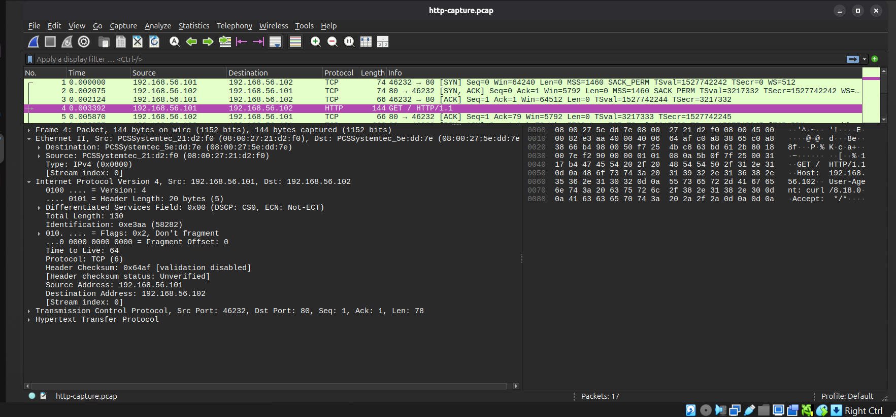
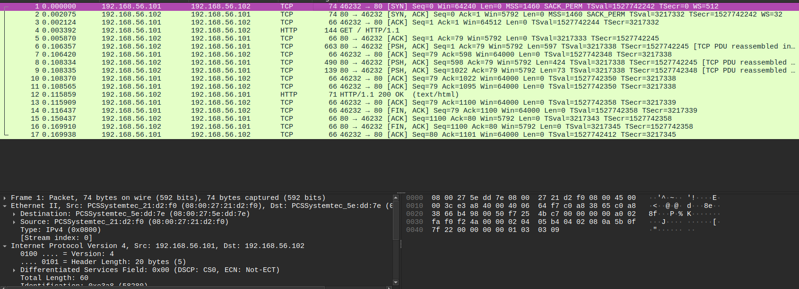

# HTTP Analysis

## 1. Overview

This section examines Hypertext Transfer Protocol (HTTP) communication between the Ubuntu analyst machine and the Metasploitable 2 web server.

The objective was to inspect the HTTP request sent by the client, analyse the server's response, and understand the application-level information exchanged over the network.

Tcpdump was used to capture the network traffic and save it as a PCAP file. Wireshark was then used to inspect individual packets and examine the HTTP protocol details.

The investigation was conducted using an HTTP request to the target web server on TCP port 80.

## 2. Lab Environment

| Component | Details |
|---|---|
| Analyst machine | Ubuntu |
| Target machine | Metasploitable 2 |
| Analyst IP | `192.168.56.101` |
| Target IP | `192.168.56.102` |
| Network interface | `enp0s8` |
| Protocol | HTTP |
| Destination port | `80` |
| Capture tool | Tcpdump |
| Analysis tool | Wireshark |
| Capture file | `http-capture.pcap` |

The investigation was performed within the isolated VirtualBox host-only network.

## 3. Capturing HTTP Traffic

### 3.1 Capture Command

The following command was used to capture traffic involving the target on port 80 and save it to a PCAP file.

```bash
sudo tcpdump -i enp0s8 -n host 192.168.56.102 and port 80 -w http-capture.pcap
```

**Command breakdown:**

| Option / Argument | Purpose |
|---|---|
| `sudo` | Runs Tcpdump with the required privileges. |
| `tcpdump` | Starts the packet capture utility. |
| `-i enp0s8` | Specifies the network interface used for capturing traffic. |
| `-n` | Prevents hostname and service-name resolution. |
| `host 192.168.56.102` | Filters traffic involving the target machine. |
| `and port 80` | Restricts the capture to traffic involving port 80. |
| `-w http-capture.pcap` | Saves captured packets to a PCAP file for later analysis. |

### 3.2 Generating HTTP Traffic

While Tcpdump was running, the following command was executed in another terminal:

```bash
curl http://192.168.56.102
```

This sent an HTTP GET request from the Ubuntu machine to the Metasploitable 2 web server.

The capture was stopped using `Ctrl + C`.

Tcpdump reported:

- 17 packets captured.
- 17 packets received by the filter.

The capture was saved as `http-capture.pcap` and opened in Wireshark.

## 4. Wireshark Inspection

The saved PCAP file was opened in Wireshark.

The following display filter was applied:
### Evidence



---

This filter helps identify packets that Wireshark recognises as HTTP traffic.

The packet list contained 17 packets representing the TCP connection and HTTP communication.

The investigation focused on the HTTP request and the corresponding server response.

## 5. HTTP and TCP Relationship
### Evidence



---
The investigation demonstrated how HTTP communication relies on TCP for reliable data transmission.

The observed communication followed this sequence:

1. The client established a TCP connection with the server through the three-way handshake.
2. The client sent an HTTP GET request for `/`.
3. The server acknowledged the request.
4. The server returned an HTTP `200 OK` response.
5. TCP divided the server's response into multiple data segments.
6. The client acknowledged the received segments.
7. Both machines terminated the TCP connection.

This demonstrates the relationship between the transport layer and the application layer.

TCP manages connection establishment, data delivery and acknowledgements, while HTTP defines the structure and meaning of the web request and response.

## 6. Security Observations

The captured HTTP communication provided several security observations.

### 6.1 Unencrypted HTTP Communication

The request and response were transmitted using HTTP over TCP port 80 without TLS encryption.

The HTTP request headers and other application-layer information could therefore be inspected directly in Wireshark.

On an unencrypted network path, an observer with access to the traffic may be able to read HTTP content, including information that should otherwise remain confidential.

### 6.2 Information Disclosure Through Headers

HTTP headers can expose information about the client and server.

In this investigation, the request revealed the client's User-Agent, while the server response provided information about the web server.

Such information can help an observer understand the technologies involved in a web connection.

### 6.3 Security Implications

Unencrypted HTTP is unsuitable for transmitting sensitive information because the communication is not protected by TLS.

HTTPS uses TLS to provide encryption and protect the confidentiality and integrity of data transmitted between the client and server.

## 7. Key Findings

The investigation established that:

1. The Ubuntu machine successfully sent an HTTP GET request to the Metasploitable 2 web server.
2. The request targeted the root resource `/` using HTTP/1.1.
3. The request contained identifiable headers, including Host, User-Agent and Accept.
4. The server returned an HTTP `200 OK` response.
5. The server response was transmitted across multiple TCP segments.
6. Wireshark was able to inspect the HTTP request and response within the captured network traffic.
7. The communication used unencrypted HTTP over TCP port 80, allowing application-layer information to be inspected directly.

## 8. Conclusion

The HTTP analysis demonstrated how a client communicates with a web server through HTTP requests and responses.

Using Tcpdump and Wireshark, the investigation captured and examined an HTTP GET request and the corresponding `200 OK` response.

The analysis also demonstrated how HTTP data is carried over TCP and how unencrypted HTTP communication can expose application-layer information to network observers.

This provided practical experience in inspecting web traffic and identifying security considerations associated with unencrypted HTTP communication.


