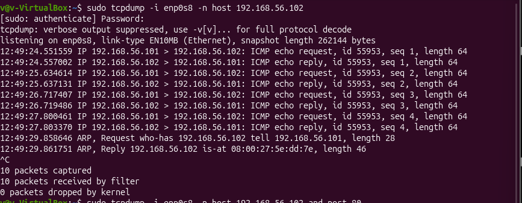

# ICMP Traffic Analysis

## 1. Overview

Following the reconnaissance and service-enumeration activities, packet analysis was conducted to examine network communication between the Ubuntu analyst machine and the Metasploitable 2 target.

This stage focused on Internet Control Message Protocol (ICMP) traffic and the Address Resolution Protocol (ARP).

Tcpdump was used to capture packets exchanged between the two virtual machines. The capture made it possible to observe ICMP Echo Requests, Echo Replies and ARP messages used during communication within the local host-only network.

The investigation helped demonstrate how network connectivity is established and how devices communicate at the network and data-link layers.

## 2. Objectives

The objectives of this activity were to:

- Capture ICMP traffic exchanged between the analyst and target machines.
- Identify ICMP Echo Requests and Echo Replies.
- Examine the ARP request and response used to resolve the target's MAC address.
- Understand the relationship between ICMP communication and ARP address resolution.

## 3. Lab Environment

| Component | Details |
|---|---|
| Analyst IP address | `192.168.56.101` |
| Target IP address | `192.168.56.102` |
| Network interface | `enp0s8` |
| Network type | VirtualBox Host-Only Network |
| Network subnet | `192.168.56.0/24` |
| Packet capture tool | Tcpdump |

The investigation was conducted within the isolated VirtualBox host-only network.

## 4. Tools Used

### 4.1 Tcpdump

Tcpdump is a command-line packet capture and analysis tool used to inspect network traffic passing through a specified network interface.

It was used to capture packets exchanged between the analyst machine and the Metasploitable 2 target.

## 5. ICMP and ARP Packet Capture

### 5.1 Capturing Traffic Between the Analyst and Target

The first packet capture was performed on the Ubuntu VM to observe traffic exchanged with the Metasploitable 2 target.

**Command:**

```bash
sudo tcpdump -i enp0s8 -n host 192.168.56.102
```

**Command explanation:**

- `sudo` provides the privileges required to capture network packets.
- `tcpdump` starts the packet capture process.
- `-i enp0s8` selects the host-only network interface.
- `-n` displays numerical IP addresses without attempting name resolution.
- `host 192.168.56.102` filters traffic involving the Metasploitable 2 target.

The filter allowed traffic to and from the target to be observed without capturing unrelated traffic from other network interfaces.

### 5.2 Observed ICMP Traffic

During the capture, four ICMP Echo Requests were observed from the analyst machine to the target, followed by four corresponding Echo Replies.

### Evidence



---|

The captured packets showed:

- Four Echo Requests sent by the analyst machine.
- Four Echo Replies returned by the target.
- An ICMP payload length of 64 bytes in each request and reply.

**Analysis:**

An ICMP Echo Request is sent by one device to determine whether another device can be reached over the network.

When the destination responds, it sends an ICMP Echo Reply back to the originating device.

The captured requests and replies demonstrated that the target was responding to ICMP communication from the analyst machine.

This provided packet-level evidence of successful communication between the two virtual machines.

### 5.3 Observed ARP Traffic

The same capture also recorded ARP communication between the two machines.

The following messages were observed:

**ARP Request:**

```text
Who has 192.168.56.102? Tell 192.168.56.101
```

**ARP Reply:**

```text
192.168.56.102 is at 08:00:27:5e:dd:7e
```

**Analysis:**

ARP is used within an IPv4 local network to resolve an IP address into the corresponding MAC address.

Before the analyst machine could send an Ethernet frame to the target, it needed to determine the MAC address associated with `192.168.56.102`.

The process involved:

1. The analyst machine broadcast an ARP Request asking which device owned the IP address `192.168.56.102`.
2. The Metasploitable 2 machine responded with its MAC address.
3. The analyst machine could then use the resolved MAC address when sending Ethernet frames to the target.

The target's observed MAC address was:

```text
08:00:27:5e:dd:7e
```

This is consistent with a VirtualBox virtual network adapter.

### 5.4 Capture Summary

The Tcpdump output reported the following:

| Capture statistic | Result |
|---|---:|
| Packets captured | 10 |
| Packets received by filter | 10 |
| Packets dropped by kernel | 0 |

The ten captured packets consisted of:

- Four ICMP Echo Requests.
- Four ICMP Echo Replies.
- One ARP Request.
- One ARP Reply.

The capture therefore provided evidence of both IP-level connectivity testing and local network address resolution.

## 6. Results and Observations

The packet capture and network verification activities established the following:

| Activity | Result | Observation |
|---|---|---|
| ICMP Echo Requests | 4 captured | The analyst machine sent requests to the target. |
| ICMP Echo Replies | 4 captured | The target responded to the requests. |
| ARP Request | 1 captured | The analyst machine requested the target's MAC address. |
| ARP Reply | 1 captured | The target supplied its MAC address. |

### Key Observations

- The target responded to all four captured ICMP Echo Requests.
- ARP was used to resolve the target's IPv4 address to its MAC address.
- The target's MAC address was recorded in the analyst machine's neighbour table.
- The routing information confirmed that traffic to the target used the host-only interface.
- Tcpdump captured ten packets, with no packets reported as dropped by the kernel.

## 7. Security Considerations

The investigation demonstrated the normal operation of ICMP and ARP within the isolated lab network.

The following security considerations are relevant:

- **ICMP exposure:** ICMP responses can reveal whether a device is reachable. Network administrators may restrict certain ICMP traffic where appropriate, while retaining traffic needed for diagnostics and network operations.
- **ARP trust:** ARP does not authenticate the identity of devices responding to address-resolution requests. This makes ARP spoofing or poisoning a potential local-network security concern.
- **Network segmentation:** Isolating vulnerable lab machines on a host-only network helps prevent unintended exposure to external networks.
- **Traffic visibility:** Packet captures can reveal communication patterns and network addressing information, making appropriate access control and protection of capture files important.

These are general security considerations and do not indicate that an ARP attack or other exploitation was performed during this activity.

## 8. Conclusion

The ICMP and ARP investigation provided practical experience in capturing and interpreting network traffic using Tcpdump.

The captured ICMP Echo Requests and Echo Replies demonstrated successful communication between the Ubuntu analyst machine and the Metasploitable 2 target.

The ARP exchange showed how the analyst machine resolved the target's IP address to its MAC address before communicating over the local network.

This activity established a foundation for the subsequent TCP and application-protocol investigations, where packet captures were used to examine connection establishment, data transfer and communication behaviour.

---
