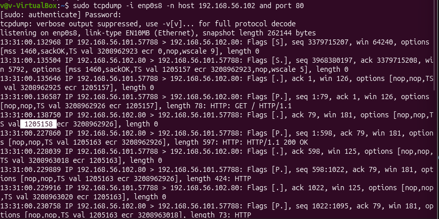
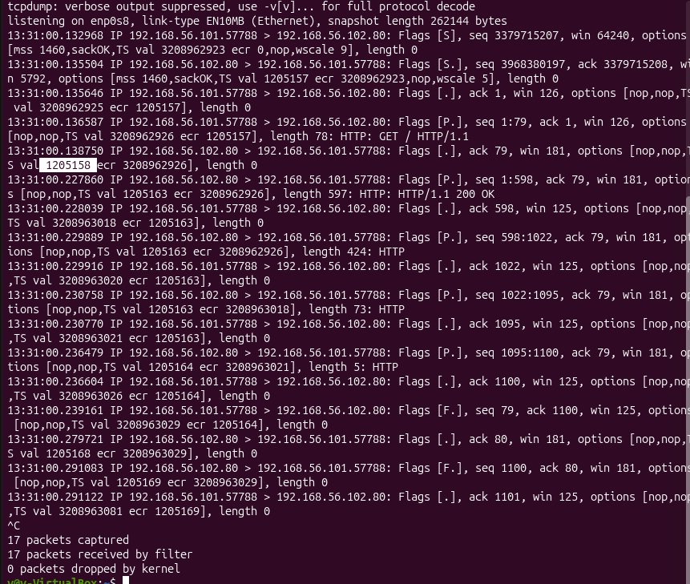
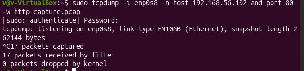

# TCP Analysis

## 1. Overview

This section examines the Transmission Control Protocol (TCP) communication between the Ubuntu analyst machine and the Metasploitable 2 target.

The analysis focuses on understanding how a TCP connection is established, how data is transmitted and acknowledged, and how the connection is terminated.

Tcpdump was used to capture network traffic, while Wireshark was used to inspect packet details and understand the TCP communication.

The HTTP request to the target's web server on port 80 generated the traffic analysed in this section.

## 2. Lab Environment

| Component | Details |
|---|---|
| Analyst machine | Ubuntu |
| Target machine | Metasploitable 2 |
| Analyst IP | `192.168.56.101` |
| Target IP | `192.168.56.102` |
| Network interface | `enp0s8` |
| Protocol | TCP |
| Destination port | `80` (HTTP) |
| Capture tool | Tcpdump |
| Packet analysis tool | Wireshark |

The capture was performed over the isolated VirtualBox host-only network.

## 3. Capturing TCP Traffic Using Tcpdump

### 3.1 Capture Command

The following command was used to capture TCP traffic between the two machines on port 80.
### Evidence



---

**Command breakdown:**

| Option / Argument | Purpose |
|---|---|
| `sudo` | Runs Tcpdump with the privileges required to capture network traffic. |
| `tcpdump` | Starts the packet capture utility. |
| `-i enp0s8` | Specifies the network interface used for capturing traffic. |
| `-n` | Prevents name resolution and displays IP addresses and port numbers numerically. |
| `host 192.168.56.102` | Filters traffic involving the Metasploitable 2 target. |
| `and port 80` | Restricts the capture to traffic involving port 80. |

### 3.2 Generating Network Traffic

After starting the capture, the following command was executed in another terminal:

```bash
curl http://192.168.56.102
```

This sent an HTTP GET request from the Ubuntu machine to the Metasploitable 2 web server.

The request generated TCP traffic that could be captured and examined.

### 3.3 Capture Results

Tcpdump reported:

- 17 packets captured.
- 17 packets received by the filter.
- 0 dropped-packet.

## 4. TCP Communication Analysis

The captured communication contained 17 packets representing a complete TCP connection between the analyst machine and the target.

The communication can be divided into three main stages:

1. TCP connection establishment.
2. Data transmission and acknowledgement.
3. TCP connection termination.

### 4.1 TCP Three-Way Handshake

Before application data can be transmitted, TCP establishes a connection using a three-way handshake.
### Evidence


---

**Understanding the handshake:**

- **SYN:** Synchronises sequence numbers and initiates the connection.
- **SYN-ACK:** Confirms the server received the client's connection request and provides its own sequence number.
- **ACK:** Confirms receipt of the server's SYN.

After these three packets, the TCP connection was established and ready for data transmission.

### 4.2 TCP Sequence and Acknowledgement Numbers

TCP uses sequence numbers to track transmitted bytes and acknowledgement numbers to indicate the next byte expected.

In the captured traffic:

- The client initiated the connection using source port `57788`.
- The target received the connection on destination port `80`.
- The client transmitted 78 bytes of TCP payload containing the HTTP GET request.
- The server acknowledged the request with acknowledgement number `79`.

The server's response was transmitted in four TCP data segments:

| Segment | Sequence Range | Payload Length |
|---|---|---:|
| 1 | `1–598` | 597 bytes |
| 2 | `598–1022` | 424 bytes |
| 3 | `1022–1095` | 73 bytes |
| 4 | `1095–1100` | 5 bytes |
| **Total** | | **1,099 bytes** |

The client acknowledged the received data progressively:

- ACK `598`
- ACK `1022`
- ACK `1095`
- ACK `1100`

This demonstrates how TCP tracks received data and acknowledges the next expected byte.

The 1,099 bytes represent the total TCP payload observed in the four server-to-client data segments. They should not be interpreted as the HTTP response body size alone.

### 4.3 TCP Flags Observed

The capture contained several TCP flags that indicate the state and purpose of individual packets.

| Flag | Meaning | Observation |
|---|---|---|
| SYN | Synchronise | Used during connection establishment. |
| ACK | Acknowledgement | Confirms receipt of transmitted data or control information. |
| PSH | Push | Appeared on packets carrying application data. |
| FIN | Finish | Used to initiate connection termination. |

The `[P.]` flag combination in the data packets represents PSH and ACK.

The `[F.]` combination represents FIN and ACK.

Packets containing only ACK flags were also observed. These acknowledged received data without carrying additional TCP payload.

## 5. TCP Connection Termination

After the HTTP request and response were exchanged, the TCP connection was closed using FIN and ACK packets.

The captured termination sequence was:

### Evidence



---

This sequence demonstrates the normal TCP connection termination process, where each side independently closes its direction of communication.

## 6. Wireshark Inspection
### Evidence



---
The saved `http-capture.pcap` file was opened in Wireshark to inspect the captured traffic in greater detail.

Wireshark provides a graphical view of packet information, including:

- Ethernet, IP and TCP protocol layers.
- Source and destination addresses and ports.
- TCP flags and sequence numbers.
- Acknowledgement numbers and advertised window sizes.
- TCP options negotiated during the handshake.
- Application data carried within TCP segments.

This made it possible to examine individual packets and understand how the TCP connection supported the HTTP communication.

The HTTP request and server response are examined in more detail in the separate HTTP analysis section.

## 7. Key Observations

The TCP capture demonstrated the following:

1. A TCP connection was successfully established between the Ubuntu analyst machine and the Metasploitable 2 target.
2. The three-way handshake consisted of SYN, SYN-ACK and ACK packets.
3. The client transmitted an HTTP GET request containing 78 bytes of TCP payload.
4. The server returned an HTTP 200 OK response across four TCP data segments.
5. The client acknowledged the received data progressively.
6. The connection was terminated through a FIN-ACK and ACK exchange in both directions.

## 8. Security Relevance

TCP analysis helps explain how network communication is established, maintained and terminated.

Understanding TCP flags, sequence numbers, acknowledgements and connection states is useful when investigating:

- Unexpected connection attempts.
- Repeated connection failures or retransmissions.
- Unusual TCP flag combinations.
- Network communication patterns.
- Potentially suspicious traffic between hosts.

TCP analysis also provides the foundation for examining application-layer protocols such as HTTP, DNS, Telnet and SSH.

## 9. Conclusion

The packet capture demonstrated a complete TCP communication between the Ubuntu analyst machine and the Metasploitable 2 web server.

Using Tcpdump, the traffic was captured and saved for further inspection. Wireshark was then used to examine packet-level details and understand the TCP connection process.

The analysis identified the three-way handshake, data transmission, acknowledgements and connection termination, providing practical insight into how TCP supports application-layer communication.
