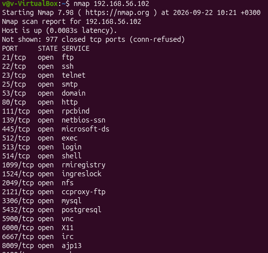
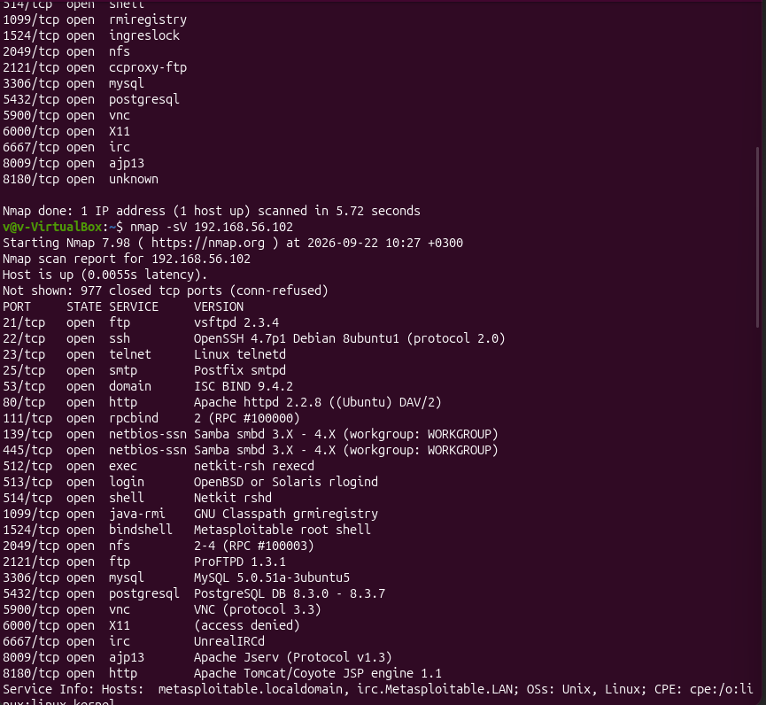
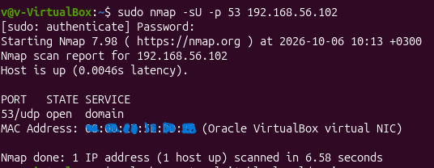

# TCP Port Scanning and Service Detection

## Objective

The objective of this activity was to identify open network ports on the Metasploitable 2 target machine and determine which services were running on those ports.

The exercise focused on:

- Identifying open and closed TCP ports.
- Understanding TCP port states.
- Using Nmap to perform port scanning.
- Identifying services running on discovered ports.
- Detecting service software and version information.
- Identifying services that may require further security investigation.

---

## 1. Performing an Initial TCP Port Scan

After confirming that the target was reachable, Nmap was used to identify open TCP ports.

The following command was executed from the Ubuntu analyst machine:

```bash
nmap 192.168.56.102
```

**Command explanation:**

- `nmap` launches the Network Mapper tool.
- `192.168.56.102` specifies the target machine.

The purpose of this scan was to identify which ports were accepting connections and which were not.

### Results

Nmap identified the target as active and returned the following results:

| Metric | Result |
|---|---|
| Target IP | `192.168.56.102` |
| Host status | Up |
| Nmap latency | 0.0083 seconds (8.3 ms) |
| Open TCP ports | 23 |
| Closed TCP ports | 977 |
| Total TCP ports scanned | 1,000 |
| Scan duration | 5.72 seconds |

The scan reported 977 closed TCP ports with the state `conn-refused`.

### Observations

- The target was reachable during the scan.
- Nmap identified 23 open TCP ports.
- The remaining 977 scanned ports were closed.
- The target responded to Nmap's probes with an observed latency of approximately 8.3 milliseconds.

An open port indicates that a service is accepting connections on that port. A closed port indicates that the target is reachable, but no application is listening on that port. A filtered port indicates that the target is being blocked by something like a firewall.

### Evidence



---

## 2. Identifying the Discovered Services

The initial scan also provided service names associated with the discovered open ports.

The results were organized according to their commonly associated services and purposes.

### TCP Port Scan Results

| Port | Service | Purpose |
|---:|---|---|
| 21 | FTP | File transfer |
| 22 | SSH | Secure remote access |
| 23 | Telnet | Remote terminal access |
| 25 | SMTP | Email transmission |
| 53 | DNS | Domain name resolution |
| 80 | HTTP | Web communication |
| 111 | RPCbind | RPC service mapping |
| 139 | NetBIOS | Network file and printer sharing |
| 445 | SMB | File and printer sharing |
| 512 | rexec | Remote command execution |
| 513 | rlogin | Remote login |
| 514 | rsh | Remote shell |
| 1099 | RMI Registry | Java remote method invocation |
| 1524 | ingreslock | Metasploitable root shell service |
| 2049 | NFS | Network file sharing |
| 2121 | FTP | Alternative FTP service |
| 3306 | MySQL | Database service |
| 5432 | PostgreSQL | Database service |
| 5900 | VNC | Remote desktop access |
| 6000 | X11 | Graphical display server |
| 6667 | IRC | Internet Relay Chat |
| 8009 | AJP13 | Apache JServ Protocol |
| 8180 | Unknown | Service requiring further identification |

### Observations

The scan revealed several categories of network services:

- **Remote access:** SSH, Telnet, rexec, rlogin and rsh.
- **File sharing:** FTP, SMB and NFS.
- **Web services:** HTTP and AJP13.
- **Database services:** MySQL and PostgreSQL.
- **Other services:** DNS, RPCbind, VNC, X11, RMI Registry and IRC.

The presence of multiple remote access, file-sharing and database services provides several areas for further investigation.

However, the service names in the initial scan are based primarily on conventional port assignments. They do not independently confirm the exact software running on each port.

---

## 3. Performing Service Version Detection

After identifying the open ports, Nmap's service version detection option was used to obtain more information about the applications running on the target.

The following command was executed:

```bash
nmap -sV 192.168.56.102
```

**Command explanation:**

- `nmap` launches the network scanning tool.
- `-sV` enables service and version detection.
- `192.168.56.102` specifies the target machine.

Unlike the initial scan, which primarily identified open ports and their commonly associated service names, this scan sent additional probes to identify the actual services and their software versions where possible.

### Results

The scan identified the following services and versions as shown in the evidence:
### Evidence



---

### Observations

The version detection scan provided additional information about the software running on the target.

Some notable observations included:

- The FTP service on port 21 was identified as vsftpd 2.3.4.
- The SSH service on port 22 was identified as OpenSSH 4.7p1.
- The web server on port 80 was identified as Apache 2.2.8.
- The alternative FTP service on port 2121 was identified as ProFTPD 1.3.1.
- The database services included MySQL 5.0.51a and PostgreSQL 8.3.x.
- Port 8180 was identified as running Apache Tomcat 5.5.

The scan also identified several legacy service versions that may require further security investigation.

Service version detection helps establish what software is running, but it does not independently confirm that a service is vulnerable or exploitable.


## 4. Performing a Targeted UDP Port Scan

In addition to TCP scanning, a targeted UDP scan was performed to check whether the target was providing DNS over UDP.

The following command was executed:

```bash
sudo nmap -sU -p 53 192.168.56.102
```

**Command explanation:**

- `sudo` runs Nmap with elevated privileges.
- `nmap` launches the scanning tool.
- `-sU` enables UDP port scanning.
- `-p 53` limits the scan to UDP port 53.
- `192.168.56.102` specifies the target machine.

UDP is a transport-layer protocol that, unlike TCP, does not establish a connection through a three-way handshake.

Port 53 is commonly used by DNS services.

### Results

### Evidence



---

### Observations

The result indicated that UDP port 53 was open and responding as a DNS service.

The initial TCP scan had also identified TCP port 53 as open.

This demonstrated that the target was providing DNS services over both TCP and UDP.

The UDP scan was limited to port 53; it was not a complete UDP scan of the target.

---

## 5. Results and Observations

The port scanning activity successfully identified exposed TCP ports and provided additional information about the services running on the target.

The main results are summarized below:

| Test | Result | Observation |
|---|---|---|
| Initial TCP scan | 23 open ports | Multiple network services identified |
| Closed TCP ports | 977 | No listening services detected on these ports |
| Service version detection | 23 services investigated | Software names and versions identified where possible |
| Targeted UDP scan | UDP 53 open | DNS service identified over UDP |
| TCP port 53 | Open | DNS service also identified over TCP |

Several services were identified as using older software versions or legacy remote access protocols.

These observations provide useful starting points for further investigation during the packet analysis and security assessment stages.

---

## 6. Security Considerations

The scan revealed several services that may introduce security risks depending on their configuration, exposure and software versions.

## 6. Preliminary Security Observations

The port scan revealed several services that may require further security investigation.

Notable observations included:

- Multiple remote access services, including Telnet, rexec, rlogin and rsh.
- Web services running on older Apache, PHP and Tomcat versions.
- FTP and database services accessible through the network.
- A Metasploitable root shell service exposed on port 1524.

These observations were recorded as potential areas of interest for subsequent assessment activities.

The security implications of selected services, particularly Telnet, SSH, HTTP and DNS, are examined further in the packet analysis section of this project.

The presence of an open port or an older software version alone does not establish that a service is vulnerable.

These are preliminary observations based on port and service detection. Further testing would be required to establish specific vulnerabilities and their impact.

---

## Conclusion

TCP port scanning and service version detection were successfully performed against the Metasploitable 2 target machine.

The initial Nmap scan identified 23 open TCP ports, revealing several services associated with remote access, file sharing, web hosting and database operations.

Service version detection provided additional information about the applications and software versions running on these ports. A targeted UDP scan also confirmed that DNS was available over UDP port 53, in addition to TCP port 53.

The results established an inventory of exposed services and identified areas requiring further security investigation.

This activity demonstrated practical understanding of:

- TCP port scanning
- UDP port scanning
- Nmap
- Port states
- Service identification
- Service version detection
- Network service enumeration
- Preliminary security assessment

All testing was conducted within a controlled and isolated VirtualBox lab environment for educational and portfolio purposes.
