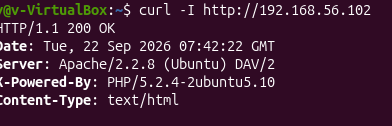
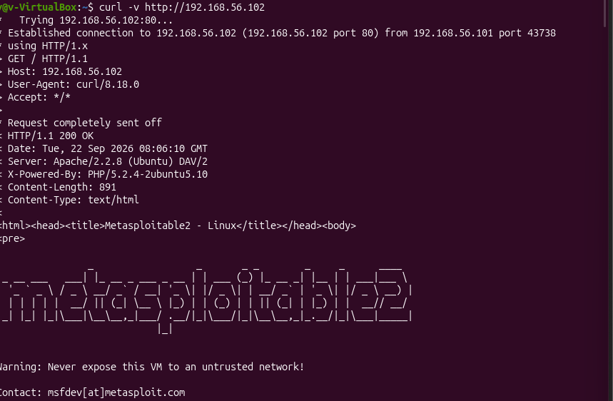
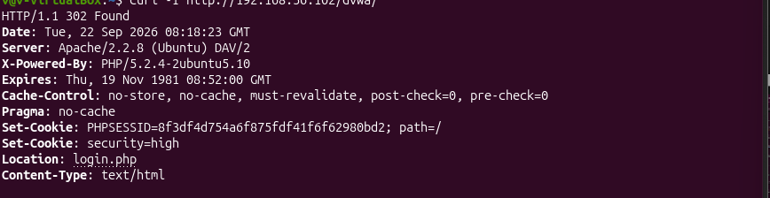
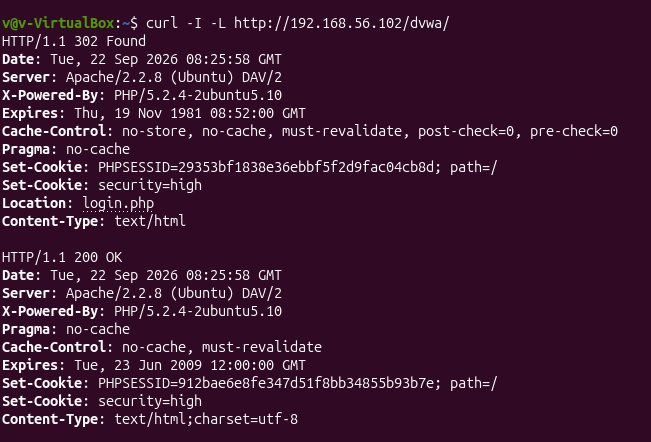
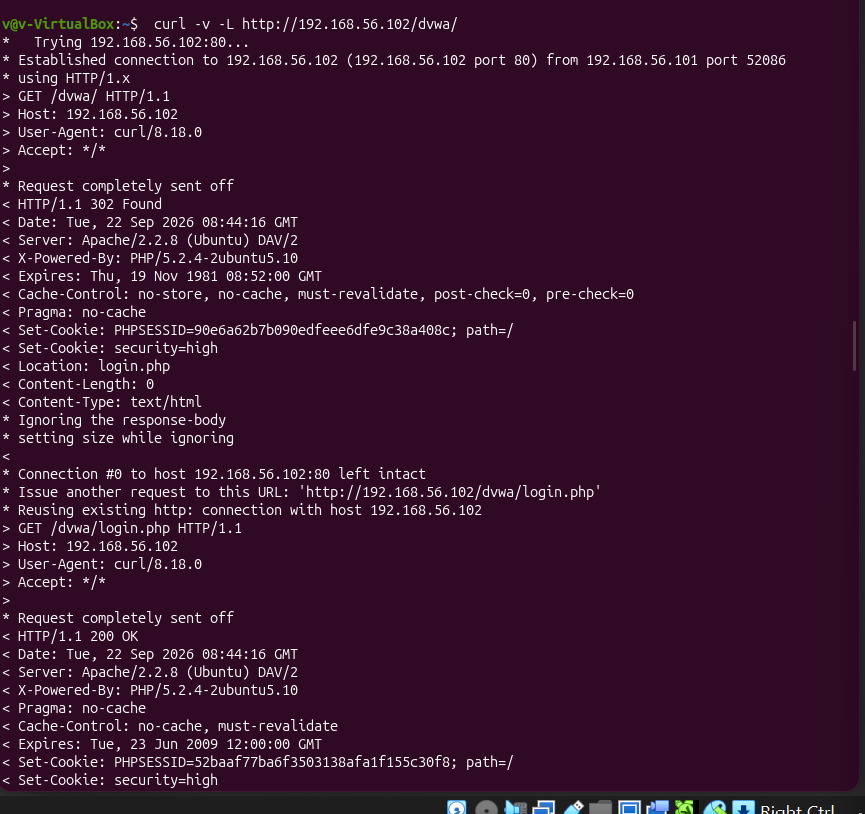
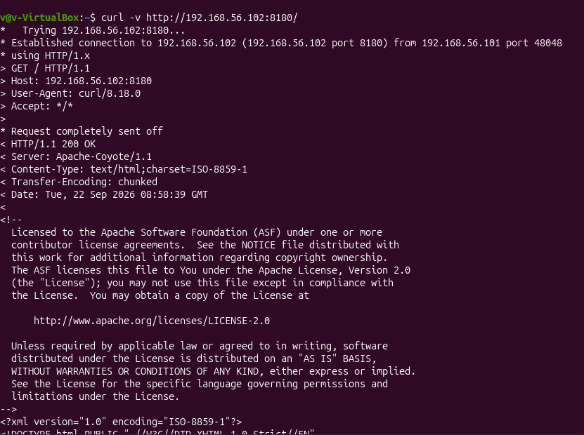

# Service Enumeration

## 1. Overview

Following the initial network reconnaissance and port-scanning activities, further investigation was conducted to examine how selected services responded to application-level requests.

The assessment focused on interacting with the HTTP services running on the Metasploitable 2 target using `curl`. This helped establish how the web server handled HTTP requests, what information was disclosed in its response headers, how application redirects were processed, and how a second web service responded on port 8180.

Unlike the initial Nmap scans, which identified accessible ports and service versions, this stage involved sending requests directly to the services and examining their responses.

## 2. Objective

The objectives of this activity were to:

- Examine HTTP response headers returned by the target web server.
- Inspect the response to a standard HTTP GET request.
- Investigate how the Damn Vulnerable Web Application (DVWA) handled HTTP redirects.
- Examine the HTTP response from the service running on port 8180.
- Identify information disclosed by the services during normal application-level communication.

## 3. Lab Environment

| Component | Details |
|---|---|
| Analyst IP address | `192.168.56.101` |
| Target IP address | `192.168.56.102` |
| Network interface | `enp0s8` |
| Network type | VirtualBox Host-Only Network |
| HTTP service | TCP port 80 |
| Additional web service | TCP port 8180 |
| Tool used | cURL |

The assessment was conducted within the isolated VirtualBox host-only network.

## 4. Tools Used

### cURL

`curl` is a command-line tool used to transfer data to and from servers using different network protocols, including HTTP and HTTPS.

It was used to send requests to the target web server and examine the responses returned.

The following options were particularly useful:

| Option | Description |
|---|---|
| `-I` | Retrieves response headers only by sending an HTTP HEAD request. |
| `-v` | Enables verbose output, displaying connection details, outgoing requests and incoming response headers. |
| `-L` | Follows HTTP redirects when the server returns a redirect response. |

## 5. Application-Level Service Investigation

### 5.1 Inspecting Apache HTTP Response Headers

The first investigation examined the HTTP response headers returned by the web server on port 80.

**Command:**

```bash
curl -I http://192.168.56.102
```

**Explanation:**

- `curl` sends a request to the specified web server.
- `-I` requests the response headers without retrieving the complete page body.
- `http://192.168.56.102` specifies the target web server.

**Observed response:**
### Evidence



---

**Analysis:**

The server returned an HTTP `200 OK` status code, indicating that the request was successfully processed.

The response headers also disclosed the following information:

- **Server:** Identified the web server as Apache/2.2.8 running on Ubuntu, with DAV/2 support.
- **X-Powered-By:** Disclosed that PHP/5.2.4-2ubuntu5.10 was being used.
- **Content-Type:** Indicated that the response contained HTML content.

This demonstrated that the web server disclosed technology and version information through its HTTP response headers.

### 5.2 Inspecting the HTTP Homepage and Request

After examining the response headers, a verbose HTTP request was made to inspect the server's response in greater detail.

**Command:**

```bash
curl -v http://192.168.56.102
```

**Explanation:**

The `-v` option enables verbose output. It displays information about:

- The connection established with the target.
- The HTTP request sent by the client.
- The response status and headers returned by the server.
- Additional connection and transfer details.

### Evidence



---

**Analysis:**

The request used the HTTP `GET` method to retrieve the root resource (`/`) from the target server.

The server successfully processed the request and returned the homepage with an HTTP `200 OK` response.

The investigation also provided additional information about the HTTP communication, including:

- The client's User-Agent, identifying the requesting tool as cURL.
- The Host header, identifying the destination web server.
- The response Content-Length, indicating the size of the response body.
- The HTML content returned by the server.

The homepage also exposed links to several web applications and resources hosted on the target, including DVWA, phpMyAdmin, Mutillidae and TWiki.

These links provided useful context for identifying additional application endpoints available for further investigation.

### 5.3 Investigating DVWA HTTP Redirects

The next investigation focused on the Damn Vulnerable Web Application (DVWA), which was accessible through the `/dvwa/` path.

The objective was to examine how the application responded when its main endpoint was requested.

**Command:**

```bash
curl -I http://192.168.56.102/dvwa/
```

**Observed response:**

### Evidence



---

The response also contained cookie-related headers, including a PHP session cookie and a security-level cookie.

**Analysis:**

The server returned an HTTP `302 Found` response.

This status code indicates that the requested resource temporarily redirects the client to another location.

The `Location` header specified:

```http
Location: login.php
```

This indicated that requests to `/dvwa/` were redirected to the application's login page.

To investigate the final response after redirection, the `-L` option was introduced.

**Command:**

```bash
curl -I -L http://192.168.56.102/dvwa/
```

**Observed behaviour:**
### Evidence



---
The server returned two responses:

1. `302 Found` — the initial request was redirected to `login.php`.
2. `200 OK` — the redirected login page was successfully retrieved.

**Analysis:**

The `-L` option instructed cURL to follow the redirect automatically.

The results confirmed that the DVWA endpoint redirected unauthenticated requests to its login page and that the destination page was accessible.

The response also demonstrated the use of HTTP cookies to maintain application session and security-level information.

### 5.4 Examining the DVWA Redirect in Verbose Mode

A further request was made using verbose mode together with redirect following to observe the complete request-and-response sequence.

**Command:**

```bash
curl -v -L http://192.168.56.102/dvwa/
```

**Observed behaviour:**
### Evidence



---

The output also showed that the existing HTTP connection was reused when following the redirect.

**Analysis:**

This investigation provided a clearer view of how the client and server handled the redirect.

It confirmed that the redirect was not an error but part of the application's normal request-handling process.

Combining `-v` and `-L` was useful because it displayed both the intermediate redirect response and the final response from the destination page.

### 5.5 Inspecting the Web Service on Port 8180

The final investigation examined another web service identified during the earlier port-scanning activity.

The service was accessible through TCP port `8180`.

A headers-only request was first used to examine its response.

**Command:**

```bash
curl -I http://192.168.56.102:8180/
```

**Observed response:**

### Evidence


---

**Analysis:**

The server returned an HTTP `200 OK` response, indicating that the requested resource was accessible.

The response headers revealed:

- **Server:** `Apache-Coyote/1.1`, identifying the HTTP connector associated with Apache Tomcat.
- **Content-Type:** Indicated that the response contained HTML encoded using ISO-8859-1.
- **Transfer-Encoding:** The value `chunked` indicated that the response body was transferred in chunks rather than being described by a single Content-Length header.

To examine the request and response in greater detail, verbose mode was used.

**Command:**

```bash
curl -v http://192.168.56.102:8180/
```

**Observed behaviour:**
### Evidence



---
The verbose output showed that:

- The response identified the server as `Apache-Coyote/1.1`.
- The response body contained an HTML page with Apache Software Foundation information.

The earlier Nmap service-version investigation had identified this service as Apache Tomcat 5.5.

**Analysis:**

The cURL investigation confirmed that the service on port 8180 was responding to HTTP requests and returning HTML content.

The `Apache-Coyote/1.1` response header provided additional evidence of the Tomcat-associated HTTP connector.

The exact Tomcat version was identified through the earlier Nmap service detection, rather than inferred from the cURL response alone.

## 6. Results and Observations

The application-level investigation produced the following results:

| Investigation | Result | Observation |
|---|---|---|
| Apache root endpoint | HTTP 200 OK | The homepage was accessible. |
| Apache response headers | Server and PHP information disclosed | Technology details were visible in HTTP headers. |
| Homepage GET request | HTTP 200 OK | The server returned the Metasploitable 2 homepage. |
| DVWA endpoint | HTTP 302 Found | Requests were redirected to `login.php`. |
| DVWA login page | HTTP 200 OK | The redirected login page was accessible. |
| DVWA session handling | Cookies returned | The application used cookies for session and security-level information. |
| Port 8180 | HTTP 200 OK | The additional web service responded successfully. |
| Port 8180 response headers | Apache-Coyote/1.1 | The response indicated a Tomcat-associated HTTP connector. |

### Key Observations

The investigation established that:

- The Apache web server disclosed its software and PHP version information through HTTP response headers.
- The root web resource was accessible and returned the Metasploitable 2 homepage.
- The homepage exposed links to multiple web applications hosted on the target.
- DVWA used an HTTP redirect to direct requests to its login page.
- The application returned session-related cookies in its HTTP responses.
- A second web service on port 8180 was accessible and returned HTML content.
- The two web services provided different server-identification information in their response headers.

## 7. Security Considerations

The observations identified several areas that may require further investigation:

- **Information disclosure:** HTTP response headers revealed server and PHP version information.
- **Application exposure:** The homepage disclosed links to multiple web applications and resources.
- **Session management:** DVWA used session cookies, making secure cookie handling an important area to examine.
- **Multiple web services:** The availability of web services on both ports 80 and 8180 increases the number of application endpoints requiring assessment.

These observations do not independently establish that the services or applications are vulnerable. Further investigation would be necessary to validate any potential weaknesses.

## 8. Conclusion

The service-enumeration activity provided a closer look at how the target's web services handled application-level HTTP requests.

Using cURL, the investigation examined Apache response headers, retrieved the target homepage, followed DVWA redirects and inspected the additional web service running on port 8180.

The results established that the services were accessible, identified information disclosed through their HTTP responses and provided insight into application behaviour.

This activity complemented the earlier Nmap reconnaissance by moving beyond identifying open ports and service versions to examining actual application responses.

The findings also provided a foundation for the subsequent packet-analysis activities, where HTTP communication and other network protocols were captured and examined using Tcpdump and Wireshark.

---

